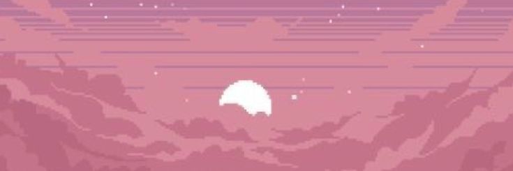

  

## About me

**Software Developer · Full Stack Developer · Software Engineering Student**

I build web applications, connect systems through APIs, and automate workflows. I hold a degree in Systems Analysis and Development and am currently studying Software Engineering. I’m particularly interested in backend engineering, software architecture, and applied AI.

## Technologies & tools

Tools and technologies I’ve used in projects, coursework, or hands-on practice.

| Area | Technologies |
| :--- | :--- |
| **Languages** | C# · Python · JavaScript · TypeScript · Java · PHP · SQL |
| **Frontend** | HTML5 · CSS3 · React · Next.js · Bootstrap |
| **Backend** | Node.js · .NET · ASP.NET Core |
| **Data & platforms** | PostgreSQL · SQL Server · MySQL · Supabase |
| **DevOps & automation** | Git · GitHub · Docker · n8n |
| **Development & design** | Postman · VS Code · Figma |

## Selected projects

| Project | What I’m building |
| :--- | :--- |
| **Vértice CRM** | A sales workspace for contacts, companies, deals, and tasks, with Supabase authentication and data synchronization. |
| **PINK** | A music library with a visual album browser and an integrated player. |

## Engineering interests

Backend engineering · Software architecture · REST APIs & webhooks · Workflow automation · Applied AI
